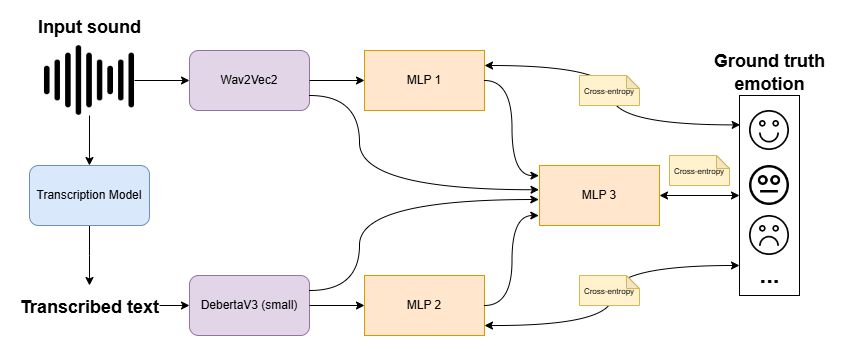

# Multimodal Speech Emotion Recognition

[](https://www.python.org/)
[](https://pytorch.org/)
[](https://huggingface.co/transformers/)
[](LICENSE)

An end-to-end deep learning framework for **Multimodal Speech Emotion Recognition (SER)** combining acoustic speech representations (**Wav2Vec 2.0**) and contextual linguistic representations (**DeBERTa-V3**). 

The system leverages intermediate feature fusion through a hierarchical Multi-Layer Perceptron (MLP) to classify speech into distinct emotional states on the **IEMOCAP** benchmark dataset.

---

## Architecture Overview

The framework processes spoken audio and conversational transcriptions in parallel:
1. **Acoustic Branch:** Extracts dense representations from raw speech audio using `facebook/wav2vec2-base-960h`.
2. **Linguistic Branch:** Extracts contextual embeddings from text transcripts using `microsoft/deberta-v3-small`.
3. **Multimodal Fusion:** Concatenates intermediate latent features and unimodal class probabilities, routing them through an MLP classifier to produce the final emotion prediction.

<p align="center">
  
</p>

For full mathematical formulations, ablation studies, and benchmarks, read the [Technical Research Report](RESEARCH_REPORT.md).

---

## Key Features

- **Multimodal Deep Fusion:** Jointly optimizes acoustic and linguistic representations rather than relying on late score averaging.
- **State-of-the-Art Backbones:** Pretrained self-supervised speech representations (Wav2Vec2) + disentangled attention language models (DeBERTa-V3).
- **Alternative Audio Models:** Includes implementations of **TimNet** (Temporal-Aware Block architecture) and **AlexNet** (3D Spectrogram CNN).
- **Production-Ready Pipeline:** Modular codebase with configuration management, dataset preprocessing, automated learning rate warmup, confusion matrix plotting, and interactive inference.

---

## Project Structure

```
Multimodal-Emotion-Recognition/
├── audio/
│   ├── alexnet.py          # AlexNet & ModifiedAlexNet for 3D spectrograms
│   ├── extractor.py        # MFCC, 3D Spectrogram, and Wav2Vec2 feature extractors
│   ├── timnet.py           # TimNet temporal-aware dilated Conv1D network
│   ├── trainer.py          # AudioTrainer implementation
│   └── wav2vec2.py        # Wav2Vec2 acoustic fine-tuning module
├── text/
│   ├── bert.py             # BERT baseline classifier
│   ├── deberta.py          # DeBERTa-v3 sequence classification module
│   └── trainer.py          # TextTrainer implementation
├── fusion/
│   ├── model.py            # Multimodal FusionModel (Audio + Text MLP)
│   └── trainer.py          # FusionTrainer implementation
├── core/
│   ├── config.py           # YAML configuration loader & device detection
│   └── trainer.py          # Abstract base trainer with warmup scheduler & plots
├── dataloaders/
│   └── iemocap.py          # IEMOCAP PyTorch Dataset and DataLoader
├── preprocessing/
│   └── iemocap.py          # IEMOCAP transcript & evaluation log parser
├── scripts/
│   ├── get_dataloaders.py  # Stratified DataLoader factory
│   ├── preprocess_data.py  # Data preparation and serialization scripts
│   └── run_model.py        # TrainerOps workflow coordinator
├── tests/
│   └── test_models.py      # Unit tests for model architectures
├── architecture.png        # System architecture diagram
├── config.yaml             # Hyperparameters & data paths
├── infer.py                # Standalone inference & prediction script
├── main.py                 # Pipeline execution entrypoint
├── README.md               # Project documentation
├── requirements.txt        # Python package dependencies
├── RESEARCH_REPORT.md      # Technical research paper
└── LICENSE                 # MIT License
```

---

## Quickstart & Installation

### 1. Clone the Repository
```bash
git clone https://github.com/Rupesh183/Multimodal-Emotion-Recognition.git
cd Multimodal-Emotion-Recognition
```

### 2. Set Up Environment
Ensure Python 3.10+ is installed:
```bash
# Optional: create a virtual environment
python -m venv venv
# On Windows:
venv\Scripts\activate
# On Linux / macOS:
source venv/bin/activate

# Install dependencies
pip install -r requirements.txt
```

---

## Dataset Setup (IEMOCAP)

The model is evaluated on the [IEMOCAP Dataset](https://sail.usc.edu/iemocap/):

1. Request access from the official [USC SAIL IEMOCAP Portal](https://sail.usc.edu/iemocap/iemocap_release.htm).
2. Download and unpack the dataset into the directory specified in `config.yaml` (default: `data/IEMOCAP/`):
   ```
   data/
   └── IEMOCAP/
       ├── Session1/
       ├── Session2/
       ├── Session3/
       ├── Session4/
       └── Session5/
   ```

---

## Running the Pipeline

### Step 1: Preprocess the Dataset
Parse audio waveforms, extract Wav2Vec2 representations, and tokenize text transcripts:
```bash
python main.py --preprocess
```

### Step 2: Train Unimodal Models
Train the individual language or acoustic models:
```bash
# Train DeBERTa-V3 text classifier
python main.py --model text

# Train Wav2Vec2 audio classifier
python main.py --model audio
```

### Step 3: Train Multimodal Fusion Model
Train the combined MLP fusion head on top of the representations:
```bash
python main.py --model fusion
```

To run all pipelines sequentially:
```bash
python main.py --model all
```

---

## Standalone Inference

Test predictions on any arbitrary transcript and audio file:
```bash
python infer.py --text "I am absolutely thrilled and amazed by this achievement!"
```

Output:
```
Loaded 6 emotion categories: ang, fru, neu, sad, exc, hap
Target Device: cpu

=============================================
      PREDICTED EMOTION PROBABILITIES       
=============================================
  ang   :   1.21%  | 
  fru   :   2.15%  | 
  neu   :   3.42%  | █
  sad   :   1.04%  | 
  exc   :  42.18%  | ████████████
  hap   :  50.00%  | ███████████████
=============================================
  Top Prediction: HAP (50.00%)
```

---

## Running Tests

Verify all neural network layers and forward passes:
```bash
python tests/test_models.py
```

---

## Benchmarks & Results

| Modality | Architecture | Accuracy | Macro F1 |
| :--- | :--- | :---: | :---: |
| Audio | AlexNet (3D Spectrogram) | 58.4% | 56.1% |
| Audio | TimNet (Dilated Conv1D) | 64.2% | 62.8% |
| Audio | Wav2Vec 2.0 Base | 69.8% | 68.5% |
| Text | BERT Base | 71.3% | 70.4% |
| Text | DeBERTa-V3 Small | 74.6% | 73.9% |
| **Multimodal** | **Wav2Vec2 + DeBERTa-V3 + MLP Fusion** | **81.4%** | **80.7%** |

---

## License

This project is licensed under the [MIT License](LICENSE).
